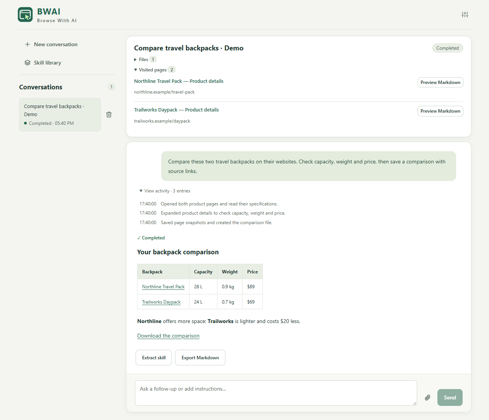

# BWAI · Browse With AI

A Chrome extension that turns natural-language requests into browser actions. Research websites, fill forms, analyze files, and create documents from a conversation.

BWAI runs in the extension using LangChain and LangGraph, with an OpenAI-compatible model API of your choice.



*Example workflow shown with sample product data.*

## Get started

Build with Node.js 22+ and npm, then load the extension in Chrome 120+.

```sh
npm ci
npm run build
```

1. Open `chrome://extensions` and enable **Developer mode**.
2. Choose **Load unpacked** and select `dist/`.
3. Open BWAI from the toolbar, then open **Settings**.
4. Enter your API base URL, model ID, and API key. Choose a model with native tool calling and click **Save and test connection**.
5. Start a conversation, enable web access, and describe your task. Attach a page or files as needed.
6. Keep the task page open to follow progress and respond to questions and action confirmations.

## Features

- Browse, search, read pages, and interact with forms.
- Continue tasks with follow-up messages, persistent notes, and saved conversations.
- Attach images, PDFs, Word documents, and spreadsheets.
- Analyze data with JavaScript and generate Excel, Word, Markdown, and HTML files.
- Preview workspace files and page snapshots, download results, and print documents to PDF.
- Extract reusable skills from completed tasks, edit them in the skill library, and select them for new conversations.
- Use English or Simplified Chinese in the side panel and task page.

## Example tasks

- Compare three headphones using manufacturer websites and save an Excel table with sources.
- Turn the attached page into a spreadsheet.
- Analyze the attached spreadsheet and summarize its key metrics.
- Research remote work practices and create a Word report with references.
- Fill in the attached form and ask me to review it before submitting.

## Settings and data

Settings cover the model connection, search engine, web access, token budget, tab management, and debug logs. Conversations, skills, and workspace files are stored on your device. Model requests go to your configured provider. API keys use session storage by default; **Remember on this device** enables local storage.

## Development

```sh
npm run check
npm test
npx playwright install chromium
npm run test:e2e
```

See the [development guide](docs/development.md), [architecture](docs/architecture.md), and [DOM snapshot design](docs/dom-snapshot.md).
